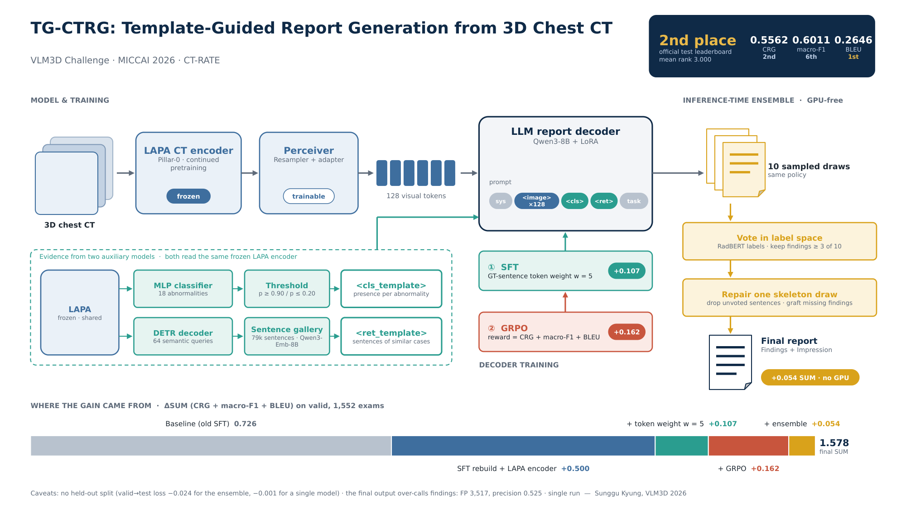

# TG-CTRG: Template-Guided CT Report Generation

2nd place, VLM3D Challenge 2026 — CT Report Generation (MICCAI 2026).

Team: Sunggu Kyung (lead), Hyekyo Jeong, Jongsoo Lim, Jiye Choi.

Chest CT volume → radiology report (Findings / Impression), trained on CT-RATE.
Hidden test set: CRG 0.5562, macro-F1 0.6011, BLEU 0.2646.

## Overview

<p align="center"></p>

| | stage | code |
|---|---|---|
| 1 | Preprocessing: resample to 1.25 mm, 256³ volumes, compressed cache; sentence-level finding labels; sentence embeddings | `rad-vision-engine/`, `pillar-pretrain/scripts/` |
| 2 | Encoder: Pillar-0 continued-pretrained with a sentence-level vision–language objective (LAPA) | `pillar-pretrain/` |
| 3 | CLS template: a classifier on the frozen encoder predicts the 18 CT-RATE findings → one sentence per finding | `pillar-finetune/` |
| 4 | RET template: a retrieval head on the frozen encoder selects sentences from a gallery of training sentences | `pillar-finetune/` |
| 5 | MLLM: frozen encoder → Perceiver → Qwen3-8B + LoRA, prompted with the two templates; supervised fine-tuning, then GRPO; ensemble of sampled reports | `CTRG-3D/` |
| 6 | Inference container that runs stages 1–5 per volume | `docker/` |

Validation split (1,552 studies, official scorer):

| | CRG | macro-F1 | BLEU |
|---|---|---|---|
| SFT with the public Pillar0-ChestCT encoder | 0.446 | 0.430 | 0.321 |
| + continued-pretrained encoder (LAPA) | 0.466 | 0.471 | 0.318 |
| + finding-weighted SFT loss | 0.505 | 0.531 | 0.326 |
| + GRPO | 0.547 | 0.597 | 0.380 |
| + ensemble (submitted) | 0.580 | 0.619 | 0.373 |

## Pretrained weights

All checkpoints are on Hugging Face: **[babbu3682/TG-CTRG](https://huggingface.co/babbu3682/TG-CTRG)** (≈21 GB). Qwen3-8B is downloaded separately from its own repository.

```bash
pip install -U "huggingface_hub[cli]"
bash scripts/hf_download_weights.sh babbu3682/TG-CTRG docker/weights
```

| file | component |
|---|---|
| `lapa_epoch12.pt` | encoder (stage 2) |
| `cls_finetune_head.pt`, `abn_thresholds_f1max_train_lapa.json` | classifier and thresholds (stage 3) |
| `ret_head.pt`, `gallery_embeddings_lasthidden.pt`, `gallery_sentences.pt` | retrieval head and gallery (stage 4) |
| `ctrg3d/model.safetensors` | MLLM after supervised fine-tuning (stage 5) |
| `lora/*.safetensors` | GRPO LoRA adapters used by the ensemble (stage 5) |
| `radbert/` | RadBERT labeler from the challenge evaluation kit (used for the ensemble vote) |

## Installation

Each subdirectory keeps its own environment (`pyproject.toml` / `requirements.txt`).
Training was done with Python 3.10, PyTorch 2.13 (CUDA 13), transformers 4.57, peft 0.17,
trl 1.10 and DeepSpeed 0.19 on A100-80GB GPUs. The inference container uses PyTorch 2.8 (CUDA 12.6).

Paths to data, checkpoints and base models are set at the top of each launcher and config;
edit them for your environment.

## Pipeline

### 1. Preprocessing

```bash
cd rad-vision-engine && pip install -e .
vision-engine process --config configs/ct_chest.yaml \
    --input-series-csv <csv of CT-RATE series> --output <cache>/train --workers 32
```
Builds the volume cache (1.25 mm isotropic, central 256 slices, 256×256, lossless compression).
Repeat for the validation split. The split files `merged_{train,valid}_filtered_prob_half.json`
hold, per study, the report, its sentences, per-sentence finding labels and the study-level labels.

```bash
cd pillar-pretrain
python scripts/cache_ctrate_embeddings_phrase_align.py --model-name <Qwen3-Embedding-8B> \
    --json-file data/merged_train_filtered_prob_half.json \
    --cache-dir data/text_cache_qwen3_embedding_8b_phrase/train
```

### 2. Encoder pretraining

```bash
cd pillar-pretrain
bash train_unimodal_pillar0_ctrate_chest_ct_1node_lapa.sh   # 2×A100, ~2 days
```
Starts from the public `Pillar0-ChestCT` weights. Each report sentence attends over the volume's
spatial tokens and is contrasted against its source volume; finding labels remove volumes with the
same finding from the negatives. The checkpoint with the lowest validation loss is used frozen in
all later stages.

### 3. CLS template

```bash
cd pillar-finetune
bash scripts/run_ctrate_abnclass.sh configs/ctrate_abnclass_finetune_lz4_pillar_self_lapa_maxpool.yaml <run_name>
python scripts/extract_abn_features.py configs/ctrate_abnclass_finetune_lz4_pillar_self_lapa_maxpool.yaml \
     --tag <tag> --splits dev,train
python scripts/tune_abn_thresholds.py --cache-dir <cache>/<tag> --head-file finetune_head.pt --output-dir <out>
python scripts/build_cls_report_templates.py --cache-dir <cache>/<tag> --head-file finetune_head.pt \
     --config configs/ctrate_abnclass_finetune_lz4_pillar_self_lapa_maxpool.yaml \
     --thresholds-json data/abn_thresholds_f1max_train_lapa.json --splits train dev --output-dir <out>
```
A small classifier on pooled encoder features predicts the 18 CT-RATE findings. Per-class
thresholds tuned on the training split turn the probabilities into one positive or negative
sentence per finding (`cls_report_{train,dev}.json`).

### 4. RET template

```bash
cd pillar-finetune
bash scripts/run_ctrate_retrieval.sh configs/ctrate_retrieval_finetune_lz4_pillar_self_lapa.yaml <run_name>
python scripts/build_gallery_lasttoken.py                       # training sentences -> embeddings
python scripts/ret_inference.py configs/ctrate_retrieval_finetune_lz4_pillar_self_lapa.yaml \
     --ckpt <run_dir>/checkpoints/best.ckpt --split train --threshold 0.4 \
     --report-output <out>/train_ret_reports.json              # and --split dev
python scripts/build_ret_report_templates.py --reports-json <out>/train_ret_reports.json \
     --display-overrides data/display_overrides.json --out-json <out>/train_ret_reports_pp.json \
     --split-json <pillar-pretrain>/data/merged_train_filtered_prob_half.json
```
A transformer decoder with learned queries maps the frozen features into the sentence-embedding
space; sentences above a similarity threshold are retrieved from the gallery and lightly normalised.

### 5. MLLM: SFT → GRPO → ensemble

```bash
cd CTRG-3D
# finding-level token weights from the sentence labels
python scripts/build_gt_sentence_weights.py --split_json <pillar-pretrain>/data/merged_train_filtered_prob_half.json \
     --gt_spans GT_report_sentence_label/train_sentence_token_labels.json \
     --gt_sentences GT_report_sentence_label/train_sentences_18labels.json \
     --out data/sentence_labels/train_gt_sentence_labels.json \
     --filtered_split_out data/sentence_labels/merged_train_gtcov.json        # and valid
# supervised fine-tuning (2×A100, LoRA r=8, 128 visual tokens, finding-token weight 5, 15 epochs)
cd scripts && LANG_ENCODER_PATH=<Qwen3-8B> LEARNING_RATE=5e-5 NUM_TRAIN_EPOCHS=15 \
     bash train.sh qwen3_joint_template_new_encoder_template_gtweight
# cache the frozen visual features and the GRPO reference statistics (see ../launchers/)
python build_vision_cache.py --ckpt <sft> --out <cache>
python build_grpo_reference_crgf1bleu.py --cache_dir <cache> --out <reference>
# GRPO: reward = alpha * CRG + gamma * dF1 - lambda * BLEU hinge
python grpo_newencB.py --ckpt <sft> --cache_dir <cache> --output_dir <run> --alpha 1 --gamma 1 --lambda_bleu 1
# sample reports from a checkpoint and label them
python generate_batched.py --ckpt <sft> --cache_dir <cache> --adapter <run>/checkpoint-<step> --out <draw>.csv
python ../src/evaluate_reportgen.py --result_csv <draw>.csv --out_dir <draw>_eval
# ensemble: vote in label space, repair one draw, verify
python label_guided_merge.py --draws <draw_1>.csv ... <draw_10>.csv --mode repair --min_support 3 \
     --backbone <index of the draw to repair> --max_add 5 --max_add_impression -1 --out ensemble.csv
python repair_verify_loop.py --merged ensemble.csv --draws <draw_1>.csv ... <draw_10>.csv \
     --min_support 3 --iters 2 --max_add 2 --out final.csv
```
The submission used four GRPO runs that differ in reward weights (CRG weight 1 or 2, F1 weight 1
or 3, with or without the BLEU term) and ten draws taken from their checkpoints with two sampler
settings. The exact draw list and sampler settings are in `docker/predict.py`; the SLURM launchers
are in `CTRG-3D/launchers/`.

### 6. Inference container

```bash
cd docker
bash make_weights.sh        # collects the files above into weights/ (or use the HF download)
bash build.sh && bash test.sh
docker run --gpus all -v <nii.gz dir>:/input -v <out>:/output -v $PWD/weights:/weights reportgen-pillar-ctrg3d
```
`predict.py` runs the full pipeline per volume: preprocessing, encoder, CLS and RET templates,
ten sampled reports from the MLLM, RadBERT labelling, label vote, repair and verification.
Output: `/output/predictions.json`.

## Citation

If you use this code or the released weights, please cite the repository (a paper will be
linked here when available):

```bibtex
@misc{kyung2026tgctrg,
  title        = {TG-CTRG: Template-Guided CT Report Generation with GRPO post-training and label-vote ensemble},
  author       = {Kyung, Sunggu and Jeong, Hyekyo and Lim, Jongsoo and Choi, Jiye},
  year         = {2026},
  howpublished = {\url{https://github.com/babbu3682/TG-CTRG}},
  note         = {GitHub repository}
}
```

## Acknowledgements

This work builds on, and was inspired by, the following projects:

- **[Pillar-0](https://github.com/YalaLab/pillar-pretrain)** (Agrawal et al., 2025, *Pillar-0: A New Frontier for Radiology Foundation Models*) — the 3D CT encoder architecture, the public `Pillar0-ChestCT` weights we start from, and the [pillar-finetune](https://github.com/YalaLab/pillar-finetune) / [RaVE](https://github.com/YalaLab/rave) tooling our stages 1–4 are derived from.
- **[RadZero](https://github.com/ahnjonggwon/RadZero)** (Park et al., 2025, *RadZero: Similarity-Based Cross-Attention for Explainable Vision-Language Alignment in Radiology with Zero-Shot Multi-Task Capability*) — the sentence-conditioned cross-attention alignment that our encoder pretraining objective extends with label-aware positives and negatives.
- **[PETRG-3D](https://github.com/Jorwnpay/PETRG-3D)** (arXiv 2511.20145) — the 3D encoder → Perceiver → LLM report-generation framework and training code that stage 5 is built on.
- **[TranSQ](https://github.com/zjukg/TranSQ)** (Kong et al., MICCAI 2022, *TranSQ: Transformer-based Semantic Query for Medical Report Generation*) — the query-based sentence retrieval formulation behind our retrieval head.

We also thank the authors of [Qwen3](https://github.com/QwenLM/Qwen3) and [Qwen3-Embedding](https://github.com/QwenLM/Qwen3-Embedding), [TRL](https://github.com/huggingface/trl) (GRPO), [PEFT](https://github.com/huggingface/peft), and the VLM3D Challenge organisers for the CT-RATE dataset and the RadBERT-based evaluation kit.

## License

Code in this repository is released under the MIT License (see `LICENSE`). The `pillar-pretrain/`, `pillar-finetune/` and `rad-vision-engine/` subtrees keep their upstream ECL-2.0 licenses and `CTRG-3D/` its upstream Apache-2.0 license. Fine-tuned weights are trained on CT-RATE (CC BY-NC-SA 4.0) and are released for non-commercial research use.
